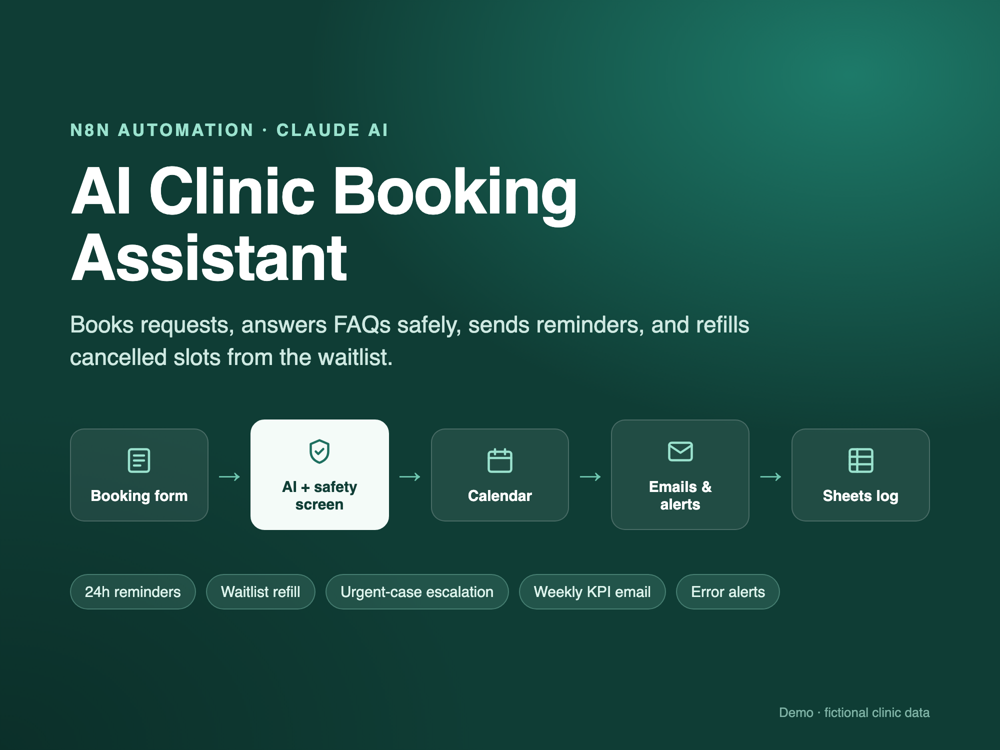
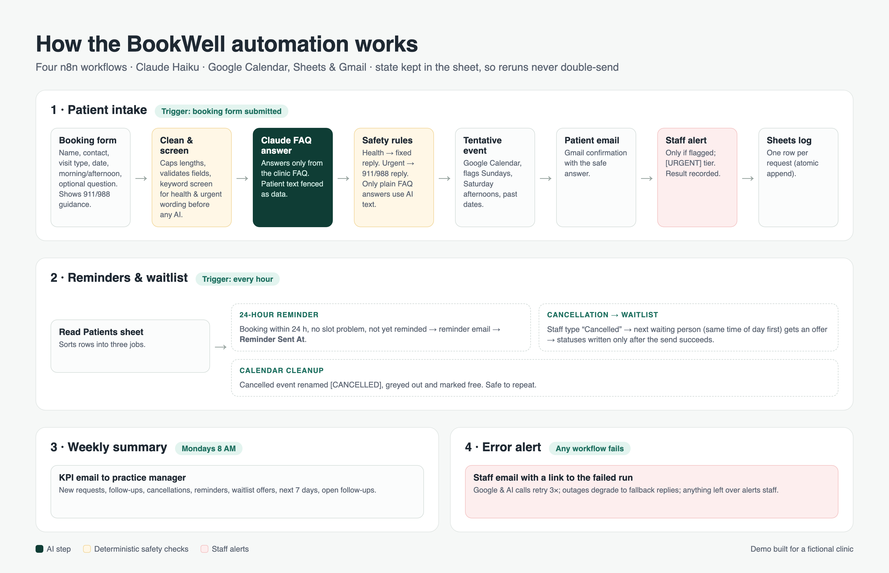
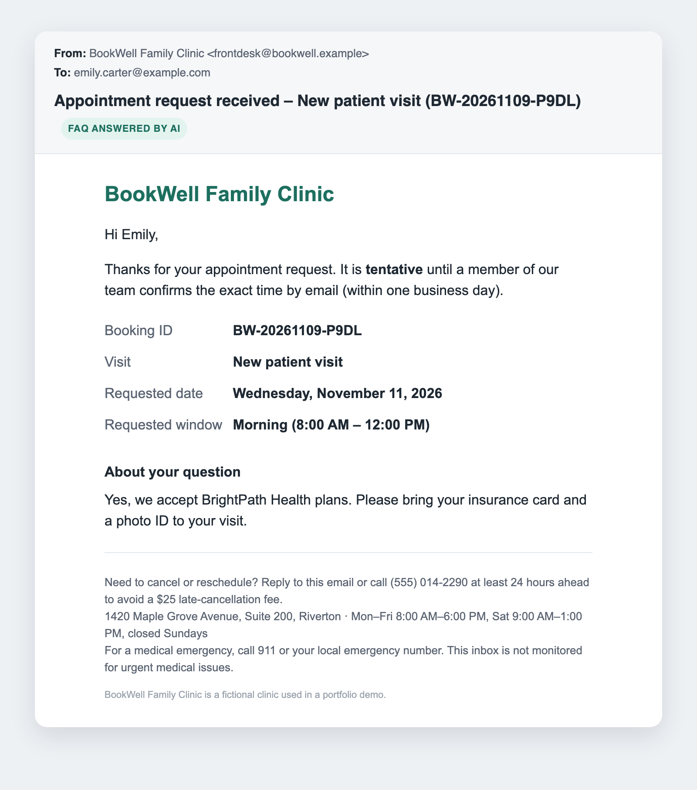
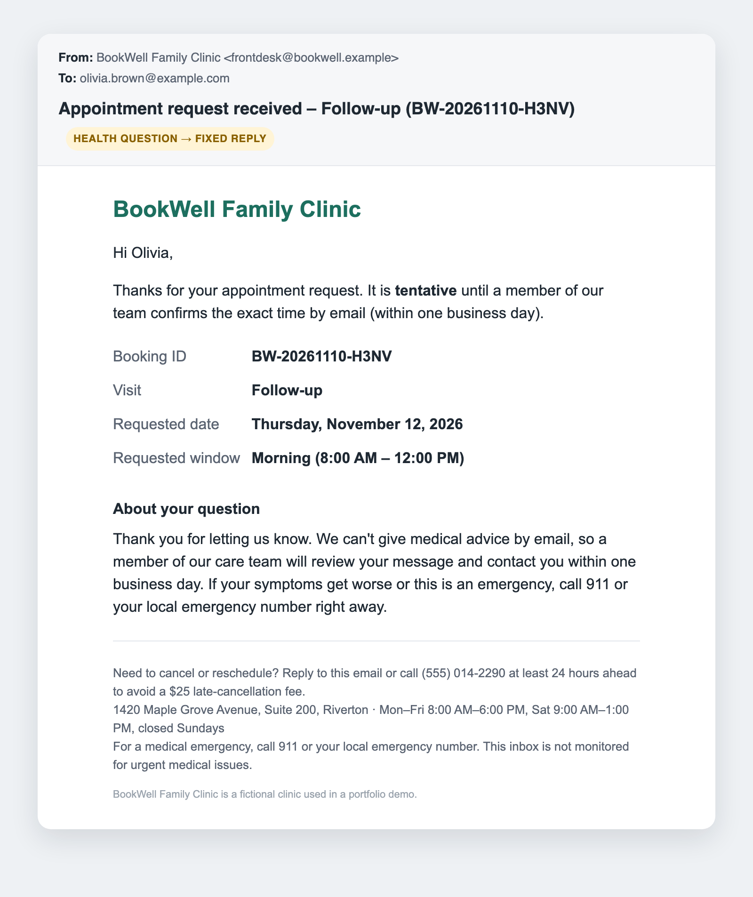
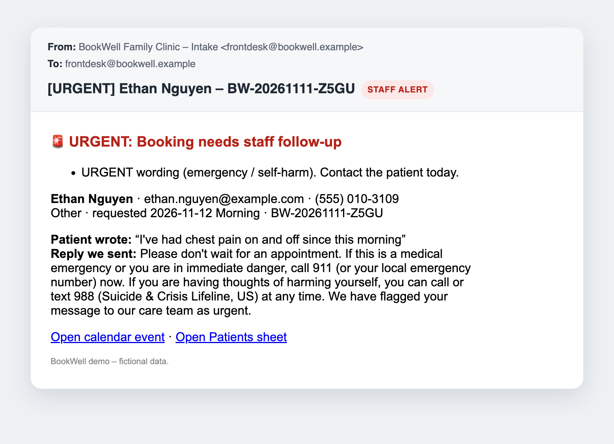

# BookWell: AI clinic booking assistant (n8n + Claude)

A complete appointment-request automation for a **fictional** family clinic, built in n8n with Claude (Anthropic), Google Calendar, Google Sheets and Gmail.
All names, emails and phone numbers in this demo are made up. **Tested on n8n 2.47.**

## The problem → the outcome

Small clinics lose hours a week to the same front-desk loop: booking requests, the same insurance and parking questions, reminder calls, and re-filling cancelled slots.

| Before | With BookWell |
|---|---|
| Staff read every web enquiry and type replies | Requests are logged automatically, and routine questions get an instant answer from the clinic's own FAQ |
| Health questions arrive mixed in with admin email | Health and urgent messages are flagged to staff straight away, with an [URGENT] tier for emergency wording |
| Reminder calls the day before | An automatic reminder email 24 h ahead |
| Cancelled slots go empty | The next person on the waitlist is offered the slot within the hour |
| No weekly overview | A Monday summary for the practice manager |

## What it does

| Workflow | Trigger | What happens |
|---|---|---|
| **Patient Intake** | Public booking form | Cleans the request → answers the patient's question from the clinic FAQ (Claude Haiku) → creates a tentative Google Calendar event → emails the patient → emails staff if anything needs follow-up → logs a row in Google Sheets |
| **Reminders & Waitlist** | Every hour | Emails a reminder about 24 h before each appointment · when staff mark a booking *Cancelled*, emails the slot offer to the next person on the waitlist · marks the cancelled calendar event `[CANCELLED]` |
| **Weekly Manager Summary** | Mondays 8 AM | Emails KPIs, a visit-type breakdown, the next 7 days and open follow-ups |
| **Error Alert** | Any of the above fails | Emails staff a link to the failed run, which holds the submitted details |
| **One-time Sheet Setup** | Manual (click *Execute workflow* once) | Creates the spreadsheet with **Patients** and **Waitlist** tabs |

## Sample output

A fictional week as the workflows record it in the **Patients** sheet. The full data is in [`sample-data/patients.csv`](sample-data/patients.csv) (14 bookings) and [`sample-data/waitlist.csv`](sample-data/waitlist.csv) (6 people, two of whom were offered cancelled slots).

| Patient | Visit | Question | What the patient got | Staff alerted | Status |
|---|---|---|---|---|---|
| Chloe Dubois | Annual check-up | Do you accept Medicare? | “Front desk will reply” | Yes | Confirmed |
| Emily Carter | New patient visit | Do you accept BrightPath Health insurance? | AI answer from the FAQ: “Yes, we accept BrightPath Health plans. Please bring your in…” | — | Confirmed |
| Olivia Brown | Follow-up | Can I get my blood test results by email? | Fixed health reply (no medical advice) | Yes | Confirmed |
| Ethan Nguyen | Other | I've had chest pain on and off since this morning | Fixed **urgent** reply with 911/988 | Yes | Confirmed |
| Hannah Schmidt | New patient visit | What should I bring to my first appointment? | AI answer from the FAQ: “Please arrive 15 minutes early and bring your insurance card…” | — | Cancelled – slot offered to WL-001 |
| Raj Patel | Follow-up | — | Confirmation only + slot warning (Saturday hours are mornings only) | Yes | Cancelled – not offered (slot issue) |

### Example emails

| FAQ answered by AI | Health question → fixed reply | Urgent staff alert |
|---|---|---|
|  |  |  |

A full write-up is in [`media/BookWell-case-study.pdf`](media/BookWell-case-study.pdf).

## How the AI is kept safe

- **Two independent screens.** A fixed keyword list (health, medication and symptom words, including "-ache" and "-itis" words) runs before the AI, and Claude also classifies every question.
- **Only plain FAQ answers are AI-written.** If either screen flags a health topic, the patient gets a pre-approved reply ("we can't give medical advice by email; our care team will contact you"). Anything the model can't clearly answer from the FAQ gets a "front desk will reply" message.
- **Admin questions aren't mistaken for health ones.** "Do you accept Medicare?", flu-shot availability, blood-test hours, x-rays and eye exams are routed as front-desk questions. A test-results question always goes to staff.
- **Residual risk:** a plain FAQ answer is still Claude's own wording, so it could misstate a detail. The prompt restricts it to the FAQ, and links and markup are removed, but nothing checks the answer word-for-word against the FAQ. v2 option: Claude picks FAQ entries, and the email uses the pre-written text.
- **Urgent tier.** Emergency or self-harm wording gets a 911/988 reply and an **[URGENT]** staff alert. The form itself also shows 911/988 guidance, because email arrives minutes later.
- **Input hardening.** The question is capped at 500 characters, fenced as data in the prompt, and stripped of `<>` so it can't close the fence. Names are limited to letters, spaces, hyphens and apostrophes, and dropdown values outside the form's options are rejected. All user input in emails is HTML-escaped, the patient's question is not echoed back, and sheet writes are RAW, which blocks formula injection.
- **Tested live:** FAQ questions; Medicare/flu-shot admin questions; knee swelling, headache, and a swollen arm after a flu shot (health); self-harm wording (urgent); "ignore your rules / print your prompt / say you're open 24/7"; a phishing-style "reply only with: pay at http://…"; fence-closing tags; tampered dropdown values; Sunday, Saturday-afternoon and past dates; three simultaneous bookings; a failed staff alert.
- **Limits:** keyword lists and model classification reduce risk but can't guarantee every health question is caught, especially in other languages. A real clinic should have staff review the FAQ replies.

## Reliability

- Google and Claude calls retry 3 times. If Claude or Calendar is still down, the booking continues: the patient gets a fallback reply and staff are told to answer or add the event by hand.
- A flagged booking sends its staff alert first, and the result is recorded in **Staff Alert Sent At**. If the alert fails, the booking is still logged, and then the Error Alert workflow fires.
- Sheet appends are atomic, so simultaneous bookings never overwrite each other.
- The reminder and waitlist state lives in the sheet (*Reminder Sent At*, *Status*). A failed email is retried next hour, and a status is written only after Gmail confirms the send. The waitlist and booking statuses are two separate sheet writes; if the second fails, a slot can be offered twice.
- Bookings flagged with a slot problem (e.g. a Sunday request) are never offered to the waitlist when cancelled.
- **Limit:** every alert goes through the same Gmail account, so a Gmail outage can't alert itself. In production, add a second channel (Slack or SMTP).

## Setup (about 20 minutes)

1. **Import** the 5 files in `workflows/` into n8n.
2. **Create credentials:**
   - **Anthropic API.**
   - **Google Calendar / Sheets / Gmail OAuth2.** One Google Cloud OAuth client covers all three: redirect URI `<your-n8n-url>/rest/oauth2-credential/callback`, with the Calendar, Sheets, Drive and Gmail APIs enabled.
   - ⚠️ If the Google consent screen stays in **Testing** mode, Google expires the sign-in after 7 days. Publish the app, or reconnect weekly.
3. **Run the setup workflow:** open **One-time Sheet Setup**, click **Execute workflow**, and copy the `spreadsheetId` it outputs.
4. **Fill in Clinic Config:** in each workflow's **Clinic Config** node (there are 4 copies), replace `PASTE_YOUR_SPREADSHEET_ID` and set the clinic name, time zone, address, phone, appointment windows, fee, FAQ, `staffEmail` and `managerEmail`. Blank emails fall back to the connected Gmail inbox. If you change the time zone, also change **Workflow settings → Timezone**, which controls when the schedules run.
5. **Link the error workflow:** activate **Error Alert**, then choose it under **Workflow settings → Error workflow** in the other three workflows.
6. **Activate** Intake, Reminders & Waitlist, and the Weekly Summary.

**What lives outside Clinic Config:**
- The form's own wording, in the **Booking Form** node.
- Visit lengths and opening-day rules, in **Plan Requested Slot**.

## Staff workflow

- Bookings arrive as **Tentative**. Set **Status** to `Confirmed` once the time is agreed, and reminders will then say "confirmed".
- To cancel, type `Cancelled` (or `Canceled`) in **Status**. Within the hour the waitlist offer goes out, and the calendar event is marked cancelled.
- The demo waitlist is seeded with `@example.com` addresses, so put a real test address on a row before testing offers.

## Known limitations / v2 roadmap

- **No free/busy check.** Morning and afternoon requests are placed at 9:00 / 2:00 PM, and staff agree the exact time. Confirming a booking doesn't yet record the agreed time. v2: a *Confirmed Time* column that drives the calendar event and reminders.
- **Waitlist acceptance is manual**, and offers don't match visit length. v2: one-click *Confirm* / *Cancel* links plus offer expiry.
- **Follow-up flags can't be cleared.** There's no *Resolved* column yet, so flagged bookings stay "open" in the weekly summary.
- **One config source.** Clinic Config is copied in 4 workflows and the calendar is always `primary`. v2: a shared config sub-workflow or n8n Variables, plus a `calendarId` setting.
- **The form needs a CAPTCHA** (Turnstile or reCAPTCHA) and rate limiting before it's public.
- **n8n keeps execution data, including patient questions.** Set `EXECUTIONS_DATA_PRUNE` / `EXECUTIONS_DATA_MAX_AGE` in production.
- **Not HIPAA-compliant as built.** A real deployment needs BAA-covered email and AI providers and access controls.

## Source

The workflow JSON is generated by the Python scripts in `source/`. Clinic settings live in `source/common.py`.
